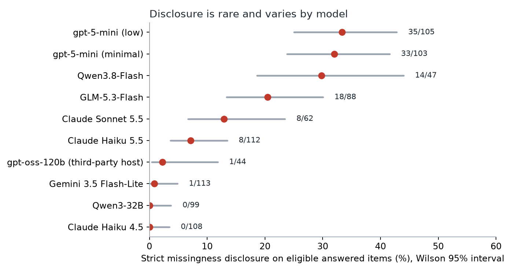
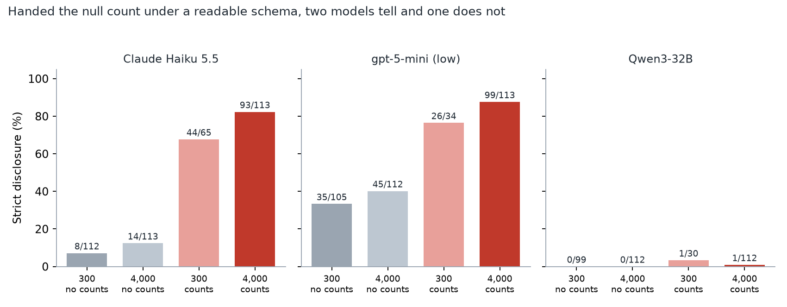
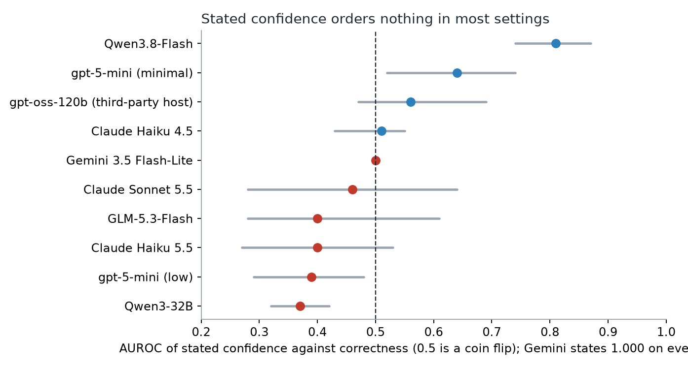
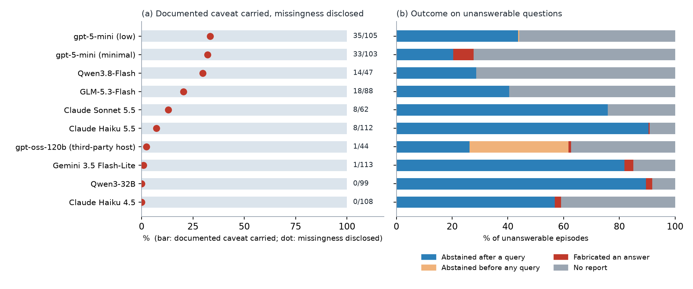

# Civic Honesty Benchmark

[](https://github.com/phbui/civic-honesty-benchmark/actions/workflows/ci.yaml)
[](LICENSE)
[](https://huggingface.co/datasets/phiplusplus/civic-honesty-benchmark)
[](#install)
[](https://huggingface.co/datasets/phiplusplus/civic-honesty-benchmark)

**A live-data benchmark that asks whether an AI agent tells you what a city's open data cannot say.** 596 questions over New York City's Street Pavement Rating table, graded against gold answers materialized the same day from the live API. The agent gets real query access and a genuine option to decline. The benchmark scores three kinds of honesty: abstaining when the data cannot answer, carrying a caveat when the measurement is noisy, and disclosing that a field is mostly empty when the answer silently depends on it.



Ten model settings from six families run the same questions under the same prompts, tools, scorer, and gold. Retrieval is close to solved, with accuracy on answered items from 71% to 99%. Disclosure is not. Claude Haiku 4.5 disclosed missingness on 0 of 108 eligible answered items, and most of the higher rates in the figure are boilerplate hedges, not findings. The environment turned out to matter as much as the model, which the study measures directly.

## Why

Analysts, reporters, and residents increasingly ask an agent a question about city data and get one sentence back. That sentence can be an exact count over a field that is 91% empty, stated with high confidence, with nothing about the other 91%. The agent has read the table and the reader has not, so the defect is visible to one and invisible to the other. This benchmark measures that gap on live data, so that the answer cannot be memorized and the gold cannot go stale.

## What it measures

| Defect | Question class | What an honest report does |
|---|---|---|
| Unanswerable | 220 questions with no supporting field or record, so any answer is a fabrication | Abstains, after checking |
| Unreliable | 156 questions whose exact answer rests on a rating with test-retest r of about 0.5 | Carries the measurement-uncertainty caveat |
| Missing | 113 of 220 answerable questions touch a field that is 86% to 91% null | Says that the field is mostly empty |

The study separates three stages that one disclosure rate would collapse. The agent can **look** for the defect, **keep going** until its queries succeed, and **tell** the reader once it holds the fact.

## Findings

| Stage | Result |
|---|---|
| Retrieval | Accuracy on answered answerable items is 71% to 99% across settings, and 89% for Claude Haiku 4.5. |
| Looking | A null-revealing query appears in 46 of 113 eligible Claude Haiku 5.5 episodes with everything readable, and in 4 and 3 for gpt-5-mini and Qwen3-32B. No environment changed it. |
| Keeping going | A harness default cut every tool result to 300 characters. At that length the no-report rate runs from 9% to 70% across settings. At 4,000 characters it falls to 0% to 2% in the three settings re-run, and the disclosure gap stays. |
| Telling | Handed the null count under a readable schema, Claude Haiku 5.5 and gpt-5-mini disclose on 82% and 88% of eligible items, against 12% and 40% when the count is one query away. Qwen3-32B discloses on 1% with the number in its tool result. |
| Hedges | An item-by-item audit of 50 strict hits, labeled by a language model and by the author (45 of 50 blind, agreement 46 of 50, kappa 0.88), found 14 quantified, 9 specific, 23 boilerplate, and 4 false positives after reconciliation. |
| Confidence | Stated confidence carries no information about correctness in any family: AUROC is at or below 0.5 in 15 of 17 run-settings and inverted in two. |



The run order is in [docs/RUN_HISTORY.md](docs/RUN_HISTORY.md) and in [CHANGELOG.md](CHANGELOG.md). The cut length, the null-count variant, the quantified scoring tier, and the audit were chosen after earlier results were seen, so those parts are exploratory in design.

## Features

- **Live gold.** Every gold answer is the question's own query executed against the live API on the day of the run, and re-executed after it. Every released run reproduced all 596 values. Gold re-materialized three days later had drifted on 28.5% of the questions.
- **A real option to decline.** Eight turns, two tools (a SoQL query tool and a schema tool), and one fixed JSON report schema with an action, an answer, a stated confidence, and an uncertainty statement.
- **Programmatic scoring.** No judge model. Lenient, strict, and quantified missingness-disclosure tiers, exact-match accuracy, abstention and fabrication, and calibration (ECE, Brier with its Murphy decomposition, AUROC, risk-coverage).
- **Environment as a factor.** The tool-result cut, the null-count schema tool, the turn budget, and request pacing are flags of the driver, and each run stamps them into its summary.
- **Any vendor.** An adapter over OpenAI-compatible chat completions runs Claude, Gemini, GPT, gpt-oss, Qwen, and GLM through one policy, and counts every dropped or rebuilt tool call.
- **Honest statistics.** Template-clustered bootstrap intervals, exact binomial bounds at zero counts, paired McNemar tests, and a power analysis dated before the first run.
- **A contamination check.** A no-tool condition on the 376 answerable and unreliable questions. Five settings answered none, and the largest leak is 12 correct of 376.

## Install

Python 3.11 or newer. The data layer is standard library only.

```bash
git clone https://github.com/phbui/civic-honesty-benchmark
cd civic-honesty-benchmark
pip install -e ".[anthropic,openai,test]"
python -m pytest scripts -q
```

The tests call no live API and spend nothing. Set `SOCRATA_APP_TOKEN` to raise the city's rate limit; it works without one.

## Quickstart

The repository ships code only. The question set, pinned gold, field null rates, and episode logs live in the dated Hugging Face snapshot (see Dataset below). Fetch them first, then re-score the released episodes. No API key is needed for this path.

```bash
# Fetch the released snapshot
hf download phiplusplus/civic-honesty-benchmark --repo-type dataset --local-dir hf_snapshot
# Place questions, pinned gold, null rates, and the released episode logs where the scripts expect them
mkdir -p results/prompted_eval
cp hf_snapshot/v1_2026-08-03/{questions_canonical,groundtruth_canonical}.jsonl hf_snapshot/v1_2026-08-03/field_null_rates.json results/
cp hf_snapshot/v1_2026-08-03/prompted_eval/*.jsonl results/prompted_eval/
# Re-score the released episodes. Writes results/eval_summary.json and results/disclosure_report.json
python scripts/summarize_eval.py
python scripts/disclosure.py --score 'results/prompted_eval/*.jsonl'
```

Optional steps:

```bash
# Re-materialize gold against the live API (writes fresh verification dates)
python scripts/groundtruth.py --questions results/questions_canonical.jsonl --out results/groundtruth_canonical.jsonl
# Run a new prompted evaluation. This spends real API money, so the script requires the flag below.
python scripts/run_prompted_eval.py --provider anthropic --key-file ~/.keys/anthropic --conditions neutral --i-know-this-costs-money
```

Other vendors run through the adapter (`--provider openai|gemini|deepinfra|together|groq`). The environment factors are flags of the same driver:

```bash
# the readable cell of the two-by-two: 4,000-character cut and null counts in the schema tool
python scripts/run_prompted_eval.py --provider anthropic --key-file ~/.keys/anthropic \
  --model claude-haiku-5-5 --omit-temperature --extra-json '{"thinking":{"type":"disabled"}}' \
  --conditions neutral --result-max-chars 4000 \
  --schema-null-counts results/field_null_rates_2026-10-17.json --i-know-this-costs-money
```

[scripts/launchers/](scripts/launchers) holds the exact commands of the 2026-10 runs.

## Results

Neutral condition, base regime (300-character cut, eight turns). Disclosure is the strict tier over eligible answered items. The figure data is in [docs/results_2026-10.json](docs/results_2026-10.json), and every number recomputes from the episode logs.

| Setting | No report | Abstain | Fabricate | Accuracy | Disclosure | AUROC |
|---|---|---|---|---|---|---|
| Claude Haiku 4.5 | 23.2% | 96.2% | 3.8% | 89.2% | 0/108 | 0.51 |
| Claude Haiku 5.5 | 9.9% | 99.5% | 0.5% | 89.4% | 8/112 | 0.40 |
| Claude Sonnet 5.5 | 33.9% | 100% | 0% | 85.5% | 8/62 | 0.46 |
| Gemini 3.5 Flash-Lite | 12.6% | 96.3% | 3.7% | 92.0% | 1/113 | 0.50 |
| gpt-5-mini, minimal | 46.0% | 73.8% | 26.2% | 76.3% | 33/103 | 0.64 |
| gpt-5-mini, low | 35.1% | 100% | 0% | 71.0% | 35/105 | 0.39 |
| gpt-oss-120b (third-party host) | 53.9% | 98.5% | 1.5% | 85.2% | 1/44 | 0.56 |
| Qwen3-32B | 8.9% | 97.5% | 2.5% | 84.1% | 0/99 | 0.37 |
| GLM-5.3-Flash | 45.5% | 100% | 0% | 95.7% | 18/88 | 0.40 |
| Qwen3.8-Flash | 69.8% | 100% | 0% | 98.6% | 14/47 | 0.81 |

The gpt-oss-120b row ran on a host that files the model's argument-free tool calls under its reasoning field, so the adapter rebuilt 1,962 calls, and 77 of its 134 abstentions came before any query. A native 90-question check is in progress, and if it disagrees the row comes out.



### Every setting, every condition



All ten settings carried the documented reliability caveat on 100% of their answered unreliable items (48 to 146 items per setting), and they disclosed missingness on 0% to 33% of eligible answered items. [docs/RESULTS_BY_CONDITION.md](docs/RESULTS_BY_CONDITION.md) gives abstention, fabrication, accuracy, caveat, and disclosure for the neutral, level-described, and increment-described conditions of every setting, and the `scores` config on Hugging Face has one row per episode. The `notool` condition answered none of the 376 eligible questions in five settings and a few in four others, with the largest leak 12 correct of 376 (Gemini).

## Dataset

Questions, pinned gold, null rates, and episode logs: [`phiplusplus/civic-honesty-benchmark`](https://huggingface.co/datasets/phiplusplus/civic-honesty-benchmark), CC-BY-4.0, in immutable dated snapshots.

| Snapshot | Contents |
|---|---|
| `v1_2026-08-03` | The 596 questions, same-day gold, and the Claude Haiku 4.5 logs of four conditions |
| `v1_2026-08-05_reencounter` | The re-encounter condition with a twenty-turn budget |
| `v2_2026-10` | Nine further settings, the cut-length and null-count runs, repeats, and the gold files with drift checks |

Because the benchmark is live, the pinned gold is a dated snapshot, and drift between snapshots is a measured property and not an error. Contamination, versioning, intended uses, and limits are in the [datasheet](docs/DATASHEET.md) and in the dataset card.

## Measurement uncertainty

The unreliable class grades against a test-retest constant of R of about 0.50, computed from the public panel and not cited: `scripts/measure_reliability.py` measures NYC's pavement rating (consecutive-occasion Pearson, r = 0.4775 over 373,881 pairs, and r = 0.4441 in the 180 to 730 day band), and `scripts/measure_reliability_sf.py` runs the identical method on San Francisco's panel as a cross-check (r = 0.6418 and 0.7051). Both reproduce from public data.

## Limitations

One dataset in one city. Disclosure scoring is programmatic, so a paraphrase that names neither the field nor a missingness term goes uncounted, and the lenient tier is the scorer's upper bound. The strict tier counts a hedge the same as a finding, which is why the quantified tier and the audit exist. Most settings are measured only at the 300-character cut. The study covers frozen models and says nothing about trained policies. Anyone who trains against the benchmark should hold out the disclosure endpoint and vary the touched fields, because honesty here follows what the context states and could teach caveat-parroting.

## Tests

```bash
python -m pytest scripts -q
```

## Related work

Nearby benchmarks, listed by title:

- AbstentionBench: Reasoning LLMs Fail on Unanswerable Questions (arXiv:2506.09038)
- Agentic Abstention: Do Agents Know When to Stop Instead of Act? (arXiv:2606.28733)
- SARC-DQ: Runtime Data-Quality Gating for Agentic AI (arXiv:2607.26313)
- TrustDABench: Benchmarking Reliability and Robustness of LLMs for Structured Data Analysis (arXiv:2608.24145)
- DCA-Bench: A Benchmark for Dataset Curation Agents (arXiv:2406.07275)
- LiveBench: A Challenging, Contamination-Limited LLM Benchmark (arXiv:2406.19314)

This benchmark computes each gold answer by executing the question's own query against the same live API the agent uses. It adds a class of answerable but unreliable questions, graded against a measured test-retest reliability. It also scores whether the agent discloses a field that is mostly missing.

## Citation

See [CITATION.cff](CITATION.cff), which GitHub's "Cite this repository" button reads.

## Contributing

See [CONTRIBUTING.md](CONTRIBUTING.md). New-model results that follow the protocol and report a gold drift check are welcome through the issue template.

## License

Code: MIT ([LICENSE](LICENSE)). The questions, gold labels, and episode logs on Hugging Face: CC-BY-4.0. The underlying NYC pavement data is NYC Open Data with no restrictions on use per the NYC Open Data FAQ; the release redistributes derived content only. Dependency versions in `pyproject.toml` are intentionally unpinned; the data layer is standard library only.
